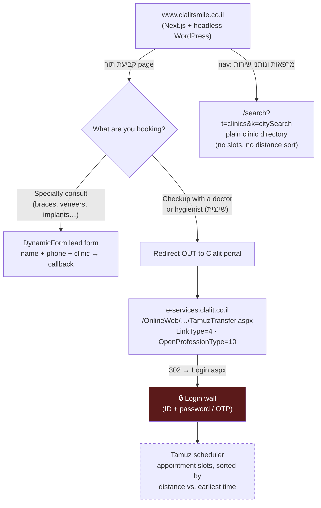
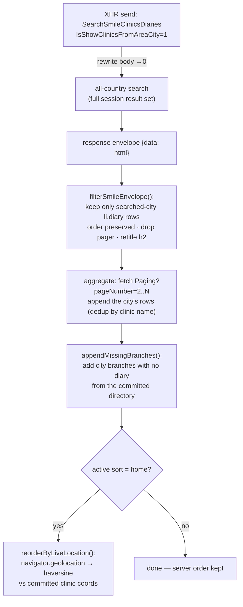
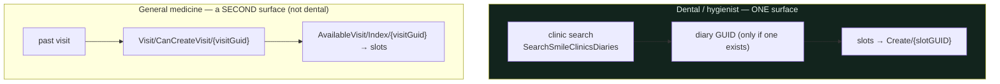

# Reverse-engineering Clalit Smile appointment scheduling

_A working log of how the booking system is put together, why the "search by city" surface lives where
it does, and exactly where this extension hooks in. Written to be read start-to-finish by a human._

---

## 1. The goal

Book a **שיננית (dental hygienist)** appointment at a **specific Clalit Smile branch**, and make the
site's search **guarantee** that a chosen city's appointments show up — while still honouring the site's
own sort toggle (**by distance** vs **by time**).

To do that we first had to answer: _where does the booking actually happen, and what does the network
traffic look like?_

---

## 2. Tools & method

Everything below was gathered from the **public** surface only — no login, no credentials.

- `curl` with a real Chrome User-Agent to fetch pages and follow redirects (`-L`, `-w "%{http_code}"`).
- `nslookup` to map hostnames.
- Parsing Next.js' embedded `__NEXT_DATA__` JSON out of the HTML (`<script id="__NEXT_DATA__">`).
- Probing candidate API/endpoint paths and reading the HTTP status + `Location` headers.

Raw artifacts (saved HTML, extracted JSON, the clinic list) live in the scratchpad; the load-bearing
findings are reproduced here.

---

## 3. Site topology — two different systems

The single most important finding: **"Clalit Smile" is a marketing brand with a marketing website, but
the actual hygienist/dentist scheduling is not on that website.** It is delegated to Clalit's national
patient portal.



### 3a. `www.clalitsmile.co.il` — the marketing site

- **Stack:** Next.js (pages router, catch-all route `/[[...uri]]`) in front of **headless WordPress**
  (WPGraphQL — every object carries a `__typename` like `MediaItem`, `ClinicPage`,
  `PageComponentsComponentsLinks`). `buildId` observed: `jsgV6pttNJBo7CngZjKrA`.
- Behind Incapsula/Imperva (an `/_Incapsula_Resource` script is injected).
- The booking page `/קביעת-תור` renders a **treatment picker** (20 specialty treatments) that feeds a
  **`DynamicForm`** — a lead-capture form (name + phone + clinic → "we'll call you back"), _not_ a
  real-time slot booker. It carries a reCAPTCHA public key and a per-treatment clinic dropdown.

### 3b. The hygienist path leaves the site

On the booking page, the tile **"זימון תור לבדיקת רופא או שיננית באתר כללית"** ("book a doctor or
hygienist appointment on the Clalit site") links to:

```
https://e-services.clalit.co.il/onlineweb/general/login.aspx
    ?CustomUrlRiderect=/Services/Tamuz/TamuzTransfer.aspx?LinkType=4&OpenProfessionType=10
```

- `e-services.clalit.co.il` is Clalit's member portal. **"Tamuz"** is the name of its appointment-
  scheduling subsystem.
- `OpenProfessionType=10` selects the profession — the hygienist/dental branch of the scheduler.
- This is where slots are shown and can be sorted **by distance** or **by earliest available time** —
  i.e. **this is the real target of "search by city".**

### 3c. The other "search by city" is a red herring

The site's nav has **"מרפאות ונותני שירות"** → `/search?t=clinics&k=citySearch`. It looks like the
feature we want, but inspecting its `__NEXT_DATA__` shows:

- `searchType: "clinics"`, `searchKind: "citySearch"`, query param is **`q`** (reflected into
  `searchParams.searchQuery`).
- **No coordinates, no distance field, no time/slot data** anywhere in the page props (`lat/lng/
  latitude/longitude/distance` all absent). The 416 `clinicCode` references it does contain all live
  inside the lead-form dropdowns, not a geo dataset.

**Conclusion:** clalitsmile's `/search` is a plain WordPress clinic **directory** — no appointment
slots and no distance-vs-time sort. The distance/time sort the user described only exists in the
**Tamuz** scheduler. So the extension's primary target is `e-services.clalit.co.il`, with clalitsmile
kept as a secondary/optional host.

---

## 4. Evidence log (HTTP probes)

| Request | Result | Reading |
|---|---|---|
| `GET www.clalitsmile.co.il/` | `200` | Next.js marketing site is public |
| `GET www.clalitsmile.co.il/קביעת-תור` | `200`, `__NEXT_DATA__` present | booking = treatment picker + DynamicForm |
| `GET .../search?t=clinics&k=citySearch&q=תל אביב` | `200`, `searchQuery:"תל אביב"` | client-side directory search, param `q` |
| `GET e-services.clalit.co.il/onlineweb/general/login.aspx` | `200` | portal login page (ASP.NET WebForms) |
| `GET .../Services/Tamuz/TamuzTransfer.aspx?LinkType=4&OpenProfessionType=10` | `302 → Login.aspx?ReturnUrl=…` | booking flow is auth-gated |
| `GET .../Services/Tamuz/` (and any `TamuzMakeAppointment.aspx`, etc.) | `302 → Login.aspx` | **every** Tamuz path needs login |
| `GET .../OnlineWeb/api/Tamuz/…` , `…/Services/Tamuz/js/*.js` | `302 → Login.aspx` | even the JS + API are behind login |
| `GET .../wp-json/` on clalitsmile | `308` | headless WordPress REST root exists |
| `GET .../graphql` on clalitsmile | `404` | WPGraphQL endpoint not public at that path |

---

## 5. The login wall — and how we got past it (for research)

`e-services.clalit.co.il` is **ASP.NET WebForms** (`__VIEWSTATE`, `ScriptResource.axd`, BotDetect
CAPTCHA) with a **modern fetch/JSON layer bolted on**. Every path under `/OnlineWeb/Services/Tamuz/`
and `/Zimunet/` returns `302 → Login.aspx` when unauthenticated — including the static `.js` — so the
real request/response shapes are invisible to anonymous probing.

To capture them we drove a **real logged-in session** under CDP (see §0-method below), which is the
only way to observe the appointment API. Everything in §6–§9 was captured this way on **2026-08-14**.

> **Research method (reproducible).** `pnpm ext:dev` launches a Chrome cloned from the real profile
> (carrying the Clalit session) with a **fixed CDP port**; a small CDP driver script attaches, navigates
> the real שיננית booking flow, and records console + network with JSON/HTML bodies. The dev loop
> **re-injects** rebuilt content scripts into the live page instead of reloading (a reload resets the
> Tamuz SPA to its home screen and loses the search state — see [`docs`](./) and the dev-takeover
> channel). No credentials are stored in the repo; the clone reuses the developer's own session.

### 5a. The authenticated entry path — and two login-session gotchas (2026-08-14)

- The working entry into the scheduler is **`/OnlineWeb/Services/Tamuz/TamuzTransfer.aspx`** — it's the
  `href` of every "זימון תורים" / "להזמין תור חדש" link on the portal home
  (`/OnlineWeb/Services/FamilyHomePage.aspx`). The prefix-less **`/Tamuz/TamuzTransfer.aspx` returns
  `500`** (not a login redirect) — logged in or not — so a 500 there says nothing about auth state.
  Found by hitting the 500 under a verified logged-in CDP session, then scraping the portal home's
  anchors for Tamuz links.
- **Don't touch the login tab while the user types.** Re-navigating the tab (or even re-GETting
  `Login.aspx`) mid-login resets the WebForms form and rotates the BotDetect CAPTCHA, producing an
  endless "התווים שהזנת לא זהים לתווים שבתמונה" loop.
- **Passive auth detection over CDP:** poll `fetch("/OnlineWeb/Services/Tamuz/TamuzTransfer.aspx",
  { redirect: "manual", credentials: "include" })` from any same-origin page — an `opaqueredirect`
  (or 500 on the legacy path) means logged out, a direct `200` means logged in — or just watch for the
  tab title to become "עמוד ראשי" (`FamilyHomePage.aspx`). Never probe `Login.aspx` itself (see above).

---

## 6. The real Tamuz "Clalit Smile" clinic-search API

The booking UI lives in an **iframe** (`#ifrmMainTamuz` → `/Zimunet/…`) inside `TamuzTransfer.aspx`.
The Smile clinic search is an **XHR** to `/Zimunet/SmileClinic/SearchSmileClinicsDiaries`, and — this is
the crux — **the response is not JSON data, it's a JSON envelope wrapping a server-rendered HTML
fragment**:

```
POST /Zimunet/SmileClinic/SearchSmileClinicsDiaries
     SelectedSpecializationCode=92           # 91=בדיקת רופא · 97=סתימה · 92=שיננית
     &SelectedCityName=תל אביב יפו
     &IsShowClinicsFromAreaCity=1            # 1 = the city's area · 0 = whole country

→ 200  { "data": "<div id=\"am_diaries\"> …<li class=\"diary\">…</li>… <nav id=\"pager\">…", … }
```

Inside `data`:

- `h2` header — `"נמצאו N תוצאות חיפוש עבור שיננית באזור: <city>"` (N = full result-set size).
- `li.diary` rows — **7 per page**; each has clinic name, `כתובת:` address line, phones, the
  soonest-slot date, a **`/nav/<code>` map link** (the key into Clalit's public geo dataset), and a
  `data-action-link` to the slot page (`/Zimunet/AvailableVisit/Smile/<diaryGuid>`).
- Three **sort** links (`a.sort` → `/Zimunet/SmileClinic/SortSmileDiaries?sortValue=X&sortDirection=Y`):
  `sortValue=4` = distance from the **searched city**, `2` = soonest appointment, `3` = distance from
  **your home**.
- A **`nav#pager`** — paging is server-session state via `/Zimunet/SmileClinic/Paging?pageNumber=N`.

**Session-bound result set.** Sort and paging operate on the server session's *last* search, and each
row's diary GUID is only valid for that session's search — you cannot mix rows from a second search in.

### 6a. "Area" is a subset — the completeness problem

`IsShowClinicsFromAreaCity=1` returns only the searched city's *area*, and its city rows are a **subset**
of what exists: an all-country search (`=0`) for "תל אביב יפו" declared **68–69** total results, of
which the address-parsed city "תל אביב יפו" appeared on more rows than the area search surfaced. And
Tamuz only lists clinics that currently have a **bookable diary** — a branch with no open diary is
absent entirely, even though it exists.

---

## 7. The three guarantees (how the extension rewrites this)

The extension patches `fetch`/`XMLHttpRequest` in the page's **MAIN world** at `document_start`, in
**all frames** (the booking UI is an iframe). The ISOLATED bridge reads the city from the search box and
the badge; both talk over a window channel (`@webext-core/messaging/page`). See
[`clalit-interceptor.content.ts`](../src/entrypoints/clalit-interceptor.content.ts),
[`clalit-bridge.content.ts`](../src/entrypoints/clalit-bridge.content.ts),
[`smile.ts`](../src/lib/smile.ts).



1. **Only the searched city, and ALL of it (completeness).**
   - The outgoing search body is rewritten `IsShowClinicsFromAreaCity=1 → 0`, so the server session
     holds the *whole country* (every row link stays valid) — then each response is **filtered to the
     city** (`li.diary` whose address's last segment matches, order preserved).
   - The remaining server pages are **aggregated**: the interceptor fetches
     `Paging?pageNumber=2..ceil(total/7)` with the page's own session and appends the city's rows,
     deduped by clinic name (diary GUIDs churn per search).
   - Branches Tamuz has **no diary** for are added as synthetic rows from a committed directory (§8), so
     a city search shows *every* branch — e.g. Tel Aviv's איילון / מגדל המאה / ירמיהו / רמת אביב /
     אוניברסיטה, not just the one bookable diary.

2. **A "distance" sort references the USER's live location.**
   - The `sortValue=4` (distance-from-searched-city) link is removed from the filtered fragment, and any
     outgoing `sortValue=4` request is rewritten to `sortValue=3`.
   - When the home-distance sort is active, the finished list is **re-ranked by `navigator.geolocation`**
     → great-circle distance ([`geo.ts`](../src/lib/geo.ts)) against committed clinic coordinates, and
     the distance label is relabelled **"מרחק ממיקומך"**. A denied/unavailable position falls back to
     the server order — no failure, just no re-rank.

3. **All external input is validated** ([`schemas.ts`](../src/lib/schemas.ts), zod): the window-channel
   config/status, the forgeable frame-relay + dev-takeover `postMessage`s, and the Smile envelope are
   parsed at the boundary; a malformed message is ignored, never thrown on.

---

## 8. Clinic directory & coordinates (the geo + completeness source)

Clalit's **public** clinic directory at `https://nearme.clalit.co.il/c.json` (the dataset behind every
row's "הצגת מפה" `/nav/<code>` link) packs ~6,900 clinics as positional rows with a column map `m`.
[`scripts/fetch-clinic-coords.ts`](../scripts/fetch-clinic-coords.ts) decodes it and generates
[`src/lib/clinic-directory.ts`](../src/lib/clinic-directory.ts):

- `SMILE_BRANCHES` — every Clalit Smile branch (title/city/street/phones/lat/lng), the source for
  listing a city's branches Tamuz has no diary for.
- `DENTAL_CLINIC_COORDS` — coordinates for **all** dental clinics (category 111), keyed by nav code, so
  live-location ranking is a static lookup with **zero runtime network, no background, no extra
  permissions**. Re-run `pnpm clinics:fetch` when Clalit opens/moves clinics.

> The older `clalitsmile` DynamicForm dataset (111 `9xxx` specialty clinics, in
> [`src/lib/clinics.ts`](../src/lib/clinics.ts)) is a *different* code space from Tamuz's nav codes and
> is kept only as reference — the `/nav/<code>` codes are what the booking flow actually uses.

---

## 9. Booking chain (mapped by a strict dry run — never fired)

Tracing one branch's `data-action-link` all the way to the mutating call:


The booking-confirm step is a **`GET /Zimunet/AvailableVisit/Create/{visitGuid}`** (the site's `et()`
handler `Ajax.send`s the slot's `data-action-link`; the response `{data:{isRedirect,redirectUrl}}`
reserves and redirects). A **dry run** across every branch diary in the result set resolved each
branch's earliest bookable slot and its exact `Create/{guid}` link **without ever GETting it** — proving
booking is reachable per branch while never reserving anything. See the dry-run recon in the scratchpad.

---

## 10. Can a branch the search omits be booked? (captured 2026-08-14)

The city-completeness guarantee lists **every** branch, including ones with no diary in the clinic
search (e.g. Tel Aviv's רמת אביב, מגדל המאה, אוניברסיטה). Whether those can be *booked* was chased
exhaustively; the answer is **no online path for a hygienist**, and here is the full evidence so it is
never re-investigated from scratch.

**There are two booking surfaces, and dental only touches one.**



- **Provider re-book is general-medicine only.** A past *general* visit (family doctor, ENT,
  ophthalmology) shows a "הזמן תור" button → `GET /Zimunet/Visit/CanCreateVisit/{visitGuid}` →
  `{data:{isRedirect,redirectTo:"/Zimunet/AvailableVisit/Index/{visitGuid}", canCreateVisit:true}}` →
  the provider's live diary (verified: a real re-book returned 8 slots, earliest next-day). **Dental
  past visits carry no re-book button at all**, `Visit/Details/{dentalGuid}` has no booking affordance,
  and `CanCreateVisit/{dentalGuid}` returns an **opaque redirect** (bounces to login). So a hygienist
  cannot be re-booked.
- **No clinic-scoped diary lookup exists.** `ClinicDoctor/ClinicDetailsByParams` ignores its query
  params and returns whatever clinic is in the server session (not the one asked for). The clinic-
  details fragment is informational only — no clinic code, no booking link. The client bundle exposes
  no "list diaries for clinic X" endpoint. The search's only inputs are
  `SelectedSpecializationCode`, `SelectedCityName`, `IsShowClinicsFromAreaCity` — no "include full/
  unavailable" flag.
- **The backend takes GUIDs, not a clinic code + date.** Availability is `GetDailyAvailableVisit?id=
  {diaryGUID}&day&month&year`; each slot is its own server-minted `Create/{slotGUID}` (no clinic/date
  in the row — the datetime is baked into the GUID); booking is a bodyless `GET Create/{slotGUID}`.
  There is nothing to forge for a clinic with no diary — the chain dead-ends at the first GUID.
- **Nationwide coverage is complete.** All-country שיננית returns 71/71 clinics (declared = collected,
  full pagination); a Tel Aviv branch would rank at distance ≈ 0 and diaries reach 2027, so absence is
  not a distance- or horizon-hidden diary — the diary genuinely does not exist.
- **Web research agrees.** Clalit's own booking guides list website / app / "תור ישר" (all the same
  Tamuz backend) and, for anything else, **phone: `*2700` or `1-800-66-66-50`** (Sun–Thu 08:00–20:00,
  Fri 08:00–13:00). No guide describes an online way to book a branch without availability — the
  fallback is the phone. This matches the API reality exactly.

**Conclusion:** a branch with no online hygienist diary is bookable only **by phone**. The extension
therefore shows every branch (completeness) but, for the ones with no diary, renders an honest
"אין יומן מקוון לשירות זה — ניתן להתקשר למרפאה" note with a `tel:` link to the clinic, and never a
dead "לכל התורים" button.

### 10a. Synthetic branch rows (how completeness is rendered)

For each searched-city branch the search omits (`SMILE_BRANCHES`, from the nearme directory), the
interceptor **clones a real server row** (never hand-authored markup — [`applyBranchToRow`](../src/lib/smile.ts))
and rewrites it: clinic name / address / phones / map, drop the slot date and the booking button, make
the phone a `tel:` link, and point **"מידע נוסף"** at the site's **own** clinic-details lightbox
(`z.showDialog('#clinicDetailsLightbox', …)` via `ClinicDoctor/ClinicDetailsByVisit/{visitGuid}`) when
the user has a past visit at that branch — matched by clinic title against `/Zimunet/` past visits —
otherwise the official `nearme.clalit.co.il/nav/{code}` page. City matching is **exact against the
site's canonical `SelectedCityName`** (the value its autocomplete commits for the search box); there is
no fuzzy normalization — the site is the single source of truth for a city's name.

---

## 11. TL;DR

- Hygienist booking is on Clalit's **Tamuz** scheduler (`e-services.clalit.co.il`, in an iframe),
  **not** on `clalitsmile.co.il`; the search is `POST /Zimunet/SmileClinic/SearchSmileClinicsDiaries`
  returning a **JSON-wrapped HTML fragment**, paged/sorted by server session.
- The extension patches `fetch`/`XHR` (MAIN world, all frames) to guarantee **(1)** only the searched
  city and **all** of it — rewriting area→all-country, filtering, aggregating pages, and adding
  no-diary branches from a committed directory as **clones of the site's own rows**; **(2)** a distance
  sort that uses the user's **live** `navigator.geolocation` against committed clinic coordinates;
  **(3)** zod validation on every external input.
- Clinic coordinates + the full branch list come from Clalit's public `nearme.clalit.co.il/c.json`,
  baked into the build so ranking needs no runtime network.
- **Booking a branch the search omits is phone-only** for a hygienist — the clinic search is dental's
  sole online surface, provider re-book is general-medicine only, and no clinic-code booking endpoint
  exists (verified against the API and Clalit's own booking guides). Synthetic rows say so and link
  `tel:`.
