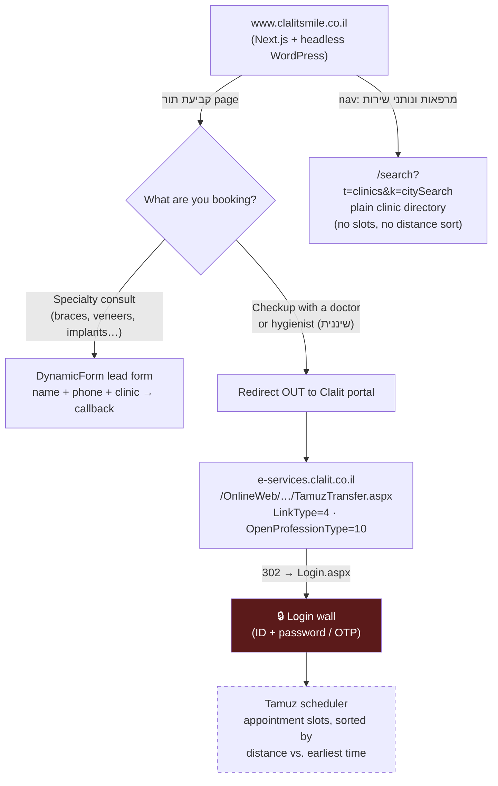
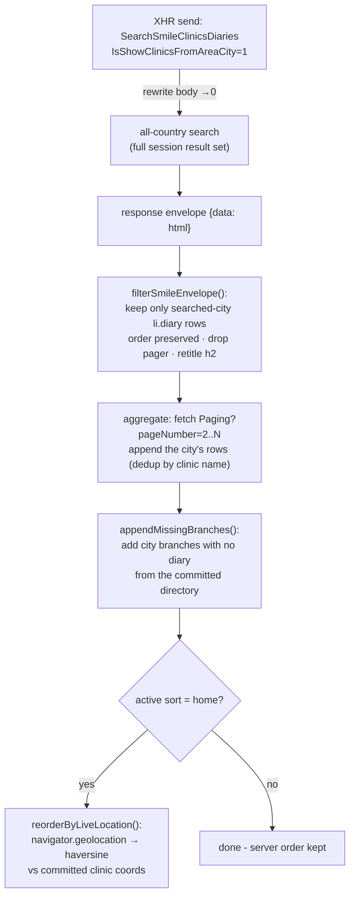
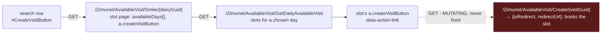
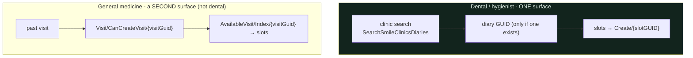

# Reverse-engineering Clalit Smile appointment scheduling

_A working log of how the booking system is put together, why the "search by city" surface lives where
it does, and exactly where this extension hooks in. Written to be read start-to-finish by a human._

---

## 1. The goal

Book a **שיננית (dental hygienist)** appointment at a **specific Clalit Smile branch**, and make the
site's search **guarantee** that a chosen city's appointments show up - while still honouring the site's
own sort toggle (**by distance** vs **by time**).

To do that we first had to answer: _where does the booking actually happen, and what does the network
traffic look like?_

---

## 2. Tools & method

Everything below was gathered from the **public** surface only - no login, no credentials.

- `curl` with a real Chrome User-Agent to fetch pages and follow redirects (`-L`, `-w "%{http_code}"`).
- `nslookup` to map hostnames.
- Parsing Next.js' embedded `__NEXT_DATA__` JSON out of the HTML (`<script id="__NEXT_DATA__">`).
- Probing candidate API/endpoint paths and reading the HTTP status + `Location` headers.

Raw artifacts (saved HTML, extracted JSON, the clinic list) live in the scratchpad; the load-bearing
findings are reproduced here.

---

## 3. Site topology - two different systems

The single most important finding: **"Clalit Smile" is a marketing brand with a marketing website, but
the actual hygienist/dentist scheduling is not on that website.** It is delegated to Clalit's national
patient portal.



### 3a. `www.clalitsmile.co.il` - the marketing site

- **Stack:** Next.js (pages router, catch-all route `/[[...uri]]`) in front of **headless WordPress**
  (WPGraphQL - every object carries a `__typename` like `MediaItem`, `ClinicPage`,
  `PageComponentsComponentsLinks`). `buildId` observed: `jsgV6pttNJBo7CngZjKrA`.
- Behind Incapsula/Imperva (an `/_Incapsula_Resource` script is injected).
- The booking page `/קביעת-תור` renders a **treatment picker** (20 specialty treatments) that feeds a
  **`DynamicForm`** - a lead-capture form (name + phone + clinic → "we'll call you back"), _not_ a
  real-time slot booker. It carries a reCAPTCHA public key and a per-treatment clinic dropdown.

### 3b. The hygienist path leaves the site

On the booking page, the tile **"זימון תור לבדיקת רופא או שיננית באתר כללית"** ("book a doctor or
hygienist appointment on the Clalit site") links to:

```
https://e-services.clalit.co.il/onlineweb/general/login.aspx
    ?CustomUrlRiderect=/Services/Tamuz/TamuzTransfer.aspx?LinkType=4&OpenProfessionType=10
```

- `e-services.clalit.co.il` is Clalit's member portal. **"Tamuz"** is the name of its appointment-
  scheduling subsystem.
- `OpenProfessionType=10` selects the profession - the hygienist/dental branch of the scheduler.
- This is where slots are shown and can be sorted **by distance** or **by earliest available time** -
  i.e. **this is the real target of "search by city".**

### 3c. The other "search by city" is a red herring

The site's nav has **"מרפאות ונותני שירות"** → `/search?t=clinics&k=citySearch`. It looks like the
feature we want, but inspecting its `__NEXT_DATA__` shows:

- `searchType: "clinics"`, `searchKind: "citySearch"`, query param is **`q`** (reflected into
  `searchParams.searchQuery`).
- **No coordinates, no distance field, no time/slot data** anywhere in the page props (`lat/lng/
  latitude/longitude/distance` all absent). The 416 `clinicCode` references it does contain all live
  inside the lead-form dropdowns, not a geo dataset.

**Conclusion:** clalitsmile's `/search` is a plain WordPress clinic **directory** - no appointment
slots and no distance-vs-time sort. The distance/time sort the user described only exists in the
**Tamuz** scheduler. So the extension's primary target is `e-services.clalit.co.il`, with clalitsmile
kept as a secondary/optional host.

---

## 4. Evidence log (HTTP probes)

| Request | Result | Reading |
|---|---|---|
| `GET www.clalitsmile.co.il/` | `200` | Next.js marketing site is public |
| `GET www.clalitsmile.co.il/קביעת-תור` | `200`, `__NEXT_DATA__` present | booking = treatment picker + DynamicForm |
| `GET .../search?t=clinics&k=citySearch&q=תל אביב` | `200`, `searchQuery:"תל אביב"` | client-side directory search, param `q` |
| `GET e-services.clalit.co.il/onlineweb/general/login.aspx` | `200` | portal login page (ASP.NET WebForms) |
| `GET .../Services/Tamuz/TamuzTransfer.aspx?LinkType=4&OpenProfessionType=10` | `302 → Login.aspx?ReturnUrl=…` | booking flow is auth-gated |
| `GET .../Services/Tamuz/` (and any `TamuzMakeAppointment.aspx`, etc.) | `302 → Login.aspx` | **every** Tamuz path needs login |
| `GET .../OnlineWeb/api/Tamuz/…` , `…/Services/Tamuz/js/*.js` | `302 → Login.aspx` | even the JS + API are behind login |
| `GET .../wp-json/` on clalitsmile | `308` | headless WordPress REST root exists |
| `GET .../graphql` on clalitsmile | `404` | WPGraphQL endpoint not public at that path |

---

## 5. The login wall - and how we got past it (for research)

`e-services.clalit.co.il` is **ASP.NET WebForms** (`__VIEWSTATE`, `ScriptResource.axd`, BotDetect
CAPTCHA) with a **modern fetch/JSON layer bolted on**. Every path under `/OnlineWeb/Services/Tamuz/`
and `/Zimunet/` returns `302 → Login.aspx` when unauthenticated - including the static `.js` - so the
real request/response shapes are invisible to anonymous probing.

To capture them we drove a **real logged-in session** under CDP (see §0-method below), which is the
only way to observe the appointment API. Everything in §6-§9 was captured this way on **2026-08-14**.

> **Research method (reproducible).** `pnpm ext:dev` launches a Chrome cloned from the real profile
> (carrying the Clalit session) with a **fixed CDP port**; a small CDP driver script attaches, navigates
> the real שיננית booking flow, and records console + network with JSON/HTML bodies. The dev loop
> **re-injects** rebuilt content scripts into the live page instead of reloading (a reload resets the
> Tamuz SPA to its home screen and loses the search state - see [`docs`](./) and the dev-takeover
> channel). No credentials are stored in the repo; the clone reuses the developer's own session.

### 5a. The authenticated entry path - and two login-session gotchas (2026-08-14)

- The working entry into the scheduler is **`/OnlineWeb/Services/Tamuz/TamuzTransfer.aspx`** - it's the
  `href` of every "זימון תורים" / "להזמין תור חדש" link on the portal home
  (`/OnlineWeb/Services/FamilyHomePage.aspx`). The prefix-less **`/Tamuz/TamuzTransfer.aspx` returns
  `500`** (not a login redirect) - logged in or not - so a 500 there says nothing about auth state.
  Found by hitting the 500 under a verified logged-in CDP session, then scraping the portal home's
  anchors for Tamuz links.
- **Don't touch the login tab while the user types.** Re-navigating the tab (or even re-GETting
  `Login.aspx`) mid-login resets the WebForms form and rotates the BotDetect CAPTCHA, producing an
  endless "התווים שהזנת לא זהים לתווים שבתמונה" loop.
- **Passive auth detection over CDP:** poll `fetch("/OnlineWeb/Services/Tamuz/TamuzTransfer.aspx",
  { redirect: "manual", credentials: "include" })` from any same-origin page - an `opaqueredirect`
  (or 500 on the legacy path) means logged out, a direct `200` means logged in - or just watch for the
  tab title to become "עמוד ראשי" (`FamilyHomePage.aspx`). Never probe `Login.aspx` itself (see above).

### 5b. The idle session-timeout dialog (captured 2026-08-14)

The portal logs an idle session out on a client-side timer, and ~2 minutes before it does it shows an
**"יש פה מישהו?"** dialog in the **top frame** (not the iframe). Left unanswered it counts down and
logs out - which resets the Tamuz SPA and loses the search. Structure, captured live from the open
dialog:

- Panel: **`#pnlSessionExpiringInfo`** (class `ModalPopupTimeout`, an AjaxControlToolkit
  ModalPopupExtender, `role="alertdialog"`). It also hosts an inner `iframe#frmRefreshSession` →
  `/OnlineWeb/ServicesForAll/RefreshSession.aspx`.
- **"המשך" (continue)** = `a#ctl00_ctl00_LogOutTimeOut_btnMasterOk_lnkSubButton` (class
  `Btn online_blue_button`), `onclick` runs `clearLogOutTimer()` then
  `__doPostBack('ctl00$ctl00$LogOutTimeOut$btnMasterOk…')` - the postback reloads `RefreshSession.aspx`
  and the session is extended.
- **"יציאה" (exit)** = `a#…btnMasterExit_lnkSubButton` (class `… weakButton`), `onclick` → `logOut()`.

The **dev server** clicks the **continue** button (a 30 s CDP poll over the top frame,
[`scripts/dev-shared.ts`](../scripts/dev-shared.ts)), reusing the portal's own refresh rather than
reimplementing a keepalive. This is dev tooling only: the shipped extension deliberately leaves the
portal's idle policy alone (an in-extension watcher existed briefly on 2026-08-14 and was removed the
same day). The exit button carries `weakButton` and its handler calls `logOut()`, so it is the
resilient discriminator against clicking the wrong one.

**The discriminator trap (found by live trigger-test, 2026-08-14).** A "reject anything smelling of
logout" hint of `/logout|יציאה/i` silently disabled the keepalive: the **continue** button's own
signature contains "logout" - its id/href say `LogOutTimeOut` (the WebForms container both buttons live
in) and its onclick calls `clearLogOutTimeout()` - so the guard rejected the continue button too and
nothing ever clicked. Captured attributes of both buttons:

- continue: id `…LogOutTimeOut_btnMasterOk_lnkSubButton`, class `Btn online_blue_button`, text "המשך",
  onclick `…clearLogOutTimeout();baseMasterBeforeSessionExpireMsg();`, href
  `javascript:__doPostBack('ctl00$ctl00$LogOutTimeOut$btnMasterOk$lnkSubButton','')`
- exit: id `…btnMasterExit_lnkSubButton`, class `Btn online_blue_button weakButton`, text "יציאה",
  onclick `…logOut();`

The exit hint therefore matches only exit-unique markers - `weakButton|btnMasterExit|יציאה` - against a
signature that includes id + class + text + onclick + href (`targets.ts`). **Repro to trigger the dialog
on demand:** the top frame's `showMP()` (inline script; also arms the real `logOut()` countdown via
`baseMasterSessionLogOutID`); the dev-server poll clicks continue within its 30 s interval - well
inside the ~2 min countdown.

---

## 6. The real Tamuz "Clalit Smile" clinic-search API

The booking UI lives in an **iframe** (`#ifrmMainTamuz` → `/Zimunet/…`) inside `TamuzTransfer.aspx`.
The Smile clinic search is an **XHR** to `/Zimunet/SmileClinic/SearchSmileClinicsDiaries`, and - this is
the crux - **the response is not JSON data, it's a JSON envelope wrapping a server-rendered HTML
fragment**:

```
POST /Zimunet/SmileClinic/SearchSmileClinicsDiaries
     SelectedSpecializationCode=92           # 91=בדיקת רופא · 97=סתימה · 92=שיננית
     &SelectedCityName=תל אביב יפו
     &IsShowClinicsFromAreaCity=1            # 1 = the city's area · 0 = whole country

→ 200  { "data": "<div id=\"am_diaries\"> …<li class=\"diary\">…</li>… <nav id=\"pager\">…", … }
```

Inside `data`:

- `h2` header - `"נמצאו N תוצאות חיפוש עבור שיננית באזור: <city>"` (N = full result-set size).
- `li.diary` rows - **7 per page**; each has clinic name, `כתובת:` address line, phones, the
  soonest-slot date, a **`/nav/<code>` map link** (the key into Clalit's public geo dataset), and a
  `data-action-link` to the slot page (`/Zimunet/AvailableVisit/Smile/<diaryGuid>`).
- Three **sort** links (`a.sort` → `/Zimunet/SmileClinic/SortSmileDiaries?sortValue=X&sortDirection=Y`):
  `sortValue=4` = distance from the **searched city**, `2` = soonest appointment, `3` = distance from
  **your home**. `sortDirection` in a rendered link is the direction the **next** click will request,
  not the one on screen (observed live 2026-08-14, 92 result set): a fresh search renders `1`; the click
  that produced a descending list left the link at `0`; clicking that `0` produced an ascending list and
  re-rendered the link as `2`. So the toggle alternates `0` ⇄ `2` with `2` = descending - which is what
  the interceptor's `sortDescending` reads off the outgoing URL.
- A **`nav#pager`** - paging is server-session state via `/Zimunet/SmileClinic/Paging?pageNumber=N`.

**Session-bound result set.** Sort and paging operate on the server session's *last* search, and each
row's diary GUID is only valid for that session's search - you cannot mix rows from a second search in.

### 6a. "Area" is a subset - the completeness problem

`IsShowClinicsFromAreaCity=1` returns only the searched city's *area*, and its city rows are a **subset**
of what exists: an all-country search (`=0`) for "תל אביב יפו" declared **68-69** total results, of
which the address-parsed city "תל אביב יפו" appeared on more rows than the area search surfaced. And
Tamuz only lists clinics that currently have a **bookable diary** - a branch with no open diary is
absent entirely, even though it exists.

### 6b. The diary GUID is minted at search time, inside the row markup (proved live 2026-08-14)

Captured with a logged-in CDP session via the DevTools network log - which sees the **raw server
response before our MAIN-world transform touches it**. The raw `SearchSmileClinicsDiaries` envelope
carries, in every `li.diary`, the row's diary GUID already baked into TWO `data-action-link`s:

```
<a … data-action-link="/Zimunet/AvailableVisit/Smile/bedb8527-fee0-4009-b3fa-ad492b4a0879">לכל התורים</a>
<a … data-action-link="/Zimunet/ClinicDoctor/ClinicDetailsByDiary/bedb8527-…">מידע נוסף</a>
```

The complete network trace for a search is: `Diary/GetCities` (autocomplete) → the ONE
`SearchSmileClinicsDiaries` POST → our aggregation `Paging?pageNumber=N` GETs. **No separate GUID-fetch
call exists** - the server mints each diary GUID during the search and renders it into the HTML
fragment; DOM clicks only consume `data-action-link`. This closes the "how is the GUID triggered"
question §10 argued from the client bundle: confirmed now from the wire.

### 6c. Click-time GUID minting - a synthetic row's "לכל התורים" (captured 2026-08-14, afternoon)

Chasing "can a branch the search omits still get a working לכל התורים button", by direct probes from a
logged-in CDP session (extension toggled OFF; `fetch` POSTs of `SearchSmileClinicsDiaries` +
`Paging` GETs with `X-Requested-With: XMLHttpRequest`, rows parsed with DOMParser):

- **A GUID cannot be pre-minted - it dies with the next search.** After running a 91 search, a GUID
  from the immediately preceding 92 search GETs `AvailableVisit/Smile/{guid}` → **200** but an error
  shell: empty `#diaryName`, `#error-panel` "תקלה זמנית. פנה לשירות הלקוחות \*2700", no
  `#availableVisitsClinicDetails`. So "mint GUIDs in the background, use them later" can never work;
  the mint must happen at click time and navigation must follow immediately.
- **A cross-specialization GUID renders a fully working slots page.** ירמיהו has no שיננית (92) diary
  but does have a בדיקת רופא (91) diary: its fresh 91 GUID rendered a real slots page - title
  "תור לבדיקת רופא שיניים", clinic ירמיהו, bookable slots (17.12.2026 14:15/14:45, ד"ר יוסף רימא). A
  branch omitted from the user's search can still carry a live "לכל התורים" if ANY of the three
  specializations lists it.
- **Same-day snapshot of the three sweeps (all-country):** 92 → 70 clinics (Tel Aviv: איילון only);
  91 → 88 clinics (Tel Aviv: ירמיהו only); 97 → **0 nationwide**. The specialization select is still
  the closed list 91/97/92. So מגדל המאה / רמת אביב / אוניברסיטה remain absent from every sweep - for
  them §10's verdict (phone only) stands unchanged; there is nothing for the server to mint.
- **"לכל התורים" is a plain iframe navigation** to `/Zimunet/AvailableVisit/Smile/{guid}` (observed by
  clicking a real row: the Zimunet iframe's location changes to that URL; the response is a full HTML
  document, not an envelope).
- **"Back" from the slots page is a DOCUMENT load** - `GET /Zimunet/SmileClinic?isRestoreSearch=True`
  re-renders the session's LAST search **server-side into the page**. Two consequences: (1) after a
  cross-spec mint, back shows that specialization's raw list (the user re-searches; the form keeps the
  city); (2) a pre-existing hole - even without minting, back after any real row's slots page shows the
  RAW last search (with the guarantee on: the unfiltered all-country list, no city filter, no synthetic
  rows), because document loads bypass the fetch/XHR patch entirely. Closed in §6d. (Minor quirk: the
  restored form's specialization select can disagree with the restored rows - observed 91 in the select
  above 92-search rows.)

**The site's diary-button handler binds by class/id, NOT by `data-action-link`** (found the hard way,
live): with the attribute stripped the site's delegated handler still fired, read the missing attribute
as `undefined`, and navigated the iframe to `/Zimunet/undefined` → 302 → clalit.co.il's MissingPage.
`preventDefault` does not silence other listeners - the interceptor must claim the click in the CAPTURE
phase and `stopPropagation` so the site's handler never sees it.

**Shipped mechanism** (interceptor + `smile.ts`): a synthetic row keeps the native button, stripped of
`data-action-link` and marked `data-clalit-city-mint-code`; clicks are claimed in capture phase.
Click → sweep NEW all-country searches, the user's submitted specialization first, then the remaining
codes (`SMILE_SPECIALIZATION_CODES`), scanning each search's pages for the branch by nav code - first
hit navigates the iframe to the fresh slots link (the site's own loader shown via `z.showLoader`).
`z.showLoader` is `function(){$.isFunction(parent.StandbyScreenShow)&&parent.StandbyScreenShow()}` - the
loader lives in the **TOP** frame (`div.loader.lottie` inside `.siteLoader`), not in the booking iframe,
so nothing inside the iframe's own DOM changes during a sweep. Verified 2026-08-14 with a top-level
`elementFromPoint` over a row button mid-sweep: it returns the loader div, i.e. the overlay covers the
iframe and a real mouse click on another row is blocked while the sweep runs (a scripted `.click()`
bypasses it and is then dropped by the interceptor's `mintInFlight` guard, silently).
Sweep miss -> re-run the user's search to restore the session, rewrite the visible real rows' slots +
details `data-action-link`s to the fresh GUIDs (every search churns ALL GUIDs, so the displayed ones
just died), then **always land in the booking flow** (Avi's call, 14.08): the branch's OWN appointments
page when a past visit keys one (§12e), otherwise the service's own page
(`SmileClinic/Index/ClalitSmile` - its SEARCH FORM, not an appointments page: it keeps the typed city but
drops the service and shows no results, §12f). The button never ends on a modal now; the
clinic's details - with the reason and the phones - live behind the row's own "מידע נוסף". Real rows are never intercepted - the native happy path is untouched.

**Saying what the wait is** (added 2026-08-14; the sweep costs 3.0-5.6 s measured). Two site internals
make it possible to speak through the site's own chrome instead of drawing our own:

- **`StandbyScreenShow()` is `StandbyScreenShowHide(true, true)`**, whose body is
  `if(!$('.loader.lottie').length>0 && ShowScreen){ $('body').append('<div class="loader lottie"><lottie-player …></div>') } else { $('.loader.lottie').remove() }`
  - so the loader is a div **created on demand in the TOP frame's body**, not a hidden node toggled.
  Two consequences: a caption appended into that div dies with it (no cleanup path to get wrong), and
  the call is a **toggle by presence** - a second `showLoader()` while one is up REMOVES it (the
  interceptor calls it once per sweep and its own page fetches bypass `z.Ajax`, which is what shows the
  site's loader). The div is `position:fixed; inset:0; display:flex; align-items/justify-content:center;
  background:rgba(255,255,255,.7); z-index:99999999` holding one 130×130 `lottie-player`, so the caption
  is absolutely positioned 85px under the centre and the site's own layout is never touched.
- **`z.showDialog(id, html)` prepends `<div id="{id}" role="dialog">{html}</div>` into `#messagesContainer`**
  (then shows `#overlay` / `#messagesOverlay`, sizes them against the top frame's `ifrmMainTamuz` offset,
  and binds close on `.close` / ESC / overlay click; `z.closeDialog` empties `#messagesContainer`).
  Since the site's OWN "מידע נוסף" handler and our composed fragment both go through it with
  `#clinicDetailsLightbox`, one insertion point covers both lightboxes - and the prepend is synchronous,
  so a composed dialog can be annotated immediately while the native one is polled for.

### 6e. Watching a branch until its diary opens (shipped 2026-08-14, REMOVED 2026-08-15)

The sweep answers "is there a slot right now?"; the watch answers "tell me when there is one". Offered on
the row and inside the fallback dialog after a miss, session-only, and deliberately cheap:

- **One service per tick, every 15 minutes**, rotating over the services that can still answer.
- **It rides the city sort**: search → `SortSmileDiaries?sortValue=4&sortDirection=1` puts the searched
  city's own branches on page 1, so a check is 1 search + 1 page (+ page 2 as a safety net) instead of
  paging the whole country. Each tick then re-runs the user's search, so the visible rows keep live GUIDs.
- **On a hit** the row reads "נפתח תור לסניף! לחצו על לכל התורים" and the service that listed it is
  remembered, so the next click mints in ONE search - measured live at **1.7 s** to the booking page.
- **It reads the envelope's status** (§12a): a service answering `errorType: 3` is dropped for the rest of
  the session (97 סתימה is empty nationwide, and every sweep used to spend a request on it), and
  `errorType: 2` stops every watch and shows "פג תוקף החיבור" - never keep asking a scheduler that has
  already locked the session.

Verified live: armed on איילון while the list was the 91 (בדיקת רופא) search; the first tick found it
under 92 after 13 s, the row flipped, and its button then reached the booking page with 2 open slots.

**Removed on Avi's call (2026-08-15): "no need for update me button".** With no control to arm it the
whole module was unreachable, so `smile-watch.ts`, the `WATCH_*` row constants and the interceptor's
watch branch went with the button. What the watch existed for is now answered at render time instead: the
availability probe (§12h) asks the same city-sorted question for every appended branch at once and paints
the ones nothing lists, so the list says "not bookable" without anyone arming anything. The mechanism
itself survives as `session.listedNavCodes`, which the probe calls - this section documents how it works
and why it is cheap.

### 6d. The restore document - "back" from a slots page (captured 2026-08-14, afternoon)

The hole §6c left open, probed on the live logged-in app (CDP, guarantee ON) and now closed.

**The back control** is `a.backToDiaries` ("חזור לבחירת מרפאה בכללית סמייל") on the slots page, carrying
`data-action-link="/Zimunet/SmileClinic?isRestoreSearch=True"` - the site's own delegated handler
DOCUMENT-navigates the Zimunet iframe there. What the server renders into that document:

- The full clinic page (search form + results), with `#am_diaries` rendered **server-side** - so no
  `fetch`/XHR carries it and the guarantee's transform never sees it. Verified: `#am_diaries` had no
  `data-clalit-city-marker`, 7 raw rows (נהריה, דימונה, צפת, …), header "נמצאו 70 תוצאות … באזור: כל
  הארץ" - our own rewritten all-country search, unfiltered, straight back in the user's face.
- **The result set is the last search's, not the last VIEW's**: the pager is restored too, and the rows
  are page 1 - the aggregation's later `Paging` calls leave no trace here.
- **The session is intact**: an immediate `Paging?pageNumber=1` from the restored document returns 200,
  and the restored rows' GUIDs still navigate to real slots pages. Nothing needs re-authenticating.
- **The form is restored with the city filled in** (`#SelectedCityName` = "תל אביב יפו"), but the
  specialization `select` is NOT authoritative - it showed 91 above the rows of a 92 search. The
  session's true specialization is only in the results header ("… חיפוש עבור **שיננית** …").
- There is a second `h2` OUTSIDE `#am_diaries` reading "שגיאה" (a hidden error placeholder). Read the
  header **scoped to `#am_diaries`**, never `document.querySelector("h2")`.
- The search button is `input.searchButton`, `type="submit"`, inside a form whose `action` is
  `SearchSmileClinicsDiaries`. The site binds a jQuery `submit` handler on the form itself that calls
  `preventDefault()` and issues the XHR (confirmed by reading `$._data(form, "events")`, jQuery 1.12.4).
  So before that handler is bound, a click would NATIVE-submit the form as a document POST.

**Shipped fix** (interceptor, `isSmileRestoreLocation` in `targets.ts`): on a restore document, read the
session's specialization from the `#am_diaries` header by matching the select's own option labels, then
**re-drive the site's own search form** (set the select, click the search button). The resulting XHR is
an ordinary search that flows through the whole existing pipeline - area→all-country rewrite, city
filter, page aggregation, synthetic branch rows, live-location re-rank - so the restored page ends up
identical to a fresh guaranteed search, with working GUIDs. Guards, each one earned from a live failure
or from the wire:

- Re-drive only once the **city is known** (`smileCity()`, i.e. the bridge has read the restored search
  box). Firing before the config arrives searches with no city and reproduces the raw all-country list -
  observed exactly once, during a dev re-injection into an already-open restore document.
- Re-drive only at `readyState === "complete"` **and** with the site's `z` namespace present, plus a
  one-shot `preventDefault` on the form's `submit`, so a too-early click can never become a native
  document POST.
- Stop as soon as any search has run in the document (our marked render, or `activeSearchCity` set by
  `patchedSend`), so exactly one search is re-driven; retries are capped at 20 × 500 ms.

After a **cross-specialization mint**, back restores that specialization's search (91), and the recovery
guarantees it as-is: "נמצאו 5 תוצאות חיפוש עבור בדיקת רופא בעיר: תל אביב יפו" - city-complete for what
the session actually holds, with ירמיהו as the real row. Switching back to שיננית is one form search.

---

## 7. The three guarantees (how the extension rewrites this)

The extension patches `fetch`/`XMLHttpRequest` in the page's **MAIN world** at `document_start`, in
**all frames** (the booking UI is an iframe). The ISOLATED bridge reads the city from the search box and
the badge; both talk over a window channel (`@webext-core/messaging/page`). See
[`clalit-interceptor.content.ts`](../src/entrypoints/clalit-interceptor.content.ts),
[`clalit-bridge.content.ts`](../src/entrypoints/clalit-bridge.content.ts),
[`smile.ts`](../src/lib/smile.ts).



1. **Only the searched city, and ALL of it (completeness).**
   - The outgoing search body is rewritten `IsShowClinicsFromAreaCity=1 → 0`, so the server session
     holds the *whole country* (every row link stays valid) - then each response is **filtered to the
     city** (`li.diary` whose address's last segment matches, order preserved).
   - The remaining server pages are **aggregated**: the interceptor fetches
     `Paging?pageNumber=2..ceil(total/7)` with the page's own session and appends the city's rows,
     deduped by clinic name (diary GUIDs churn per search).
   - Branches Tamuz has **no diary** for are added as synthetic rows from a committed directory (§8), so
     a city search shows *every* branch - e.g. Tel Aviv's איילון / מגדל המאה / ירמיהו / רמת אביב /
     אוניברסיטה, not just the one bookable diary.

2. **A "distance" sort references the USER's live location.**
   - The `sortValue=4` (distance-from-searched-city) link is removed from the filtered fragment, and any
     outgoing `sortValue=4` request is rewritten to `sortValue=3`.
   - When the home-distance sort is active, the finished list is **re-ranked by `navigator.geolocation`**
     → great-circle distance ([`geo.ts`](../src/lib/geo.ts)) against committed clinic coordinates, and
     the distance label is relabelled **"מרחק ממיקומך"**. A denied/unavailable position falls back to
     the server order - no failure, just no re-rank.
   - Verified live 2026-08-14 (both halves): with the origin's location permission **denied** - the
     state the dev profile inherits from the real Chrome - the sort still returned a correctly
     guaranteed list in the server's home-distance order, keeping the server's own "מרחק מהבית שלך"
     label, silently. With the permission granted (`Browser.grantPermissions` over CDP, held open - the
     override dies with the client session) and a position emulated at רמת אביב, all five Tel Aviv rows
     re-ranked from the committed coordinates, synthetic rows included: 0.01 → 2.77 → 3.13 → 5.42 →
     5.76 km, each relabelled "מרחק ממיקומך", with the direction toggle mirroring the site's own.

3. **All external input is validated** ([`schemas.ts`](../src/lib/schemas.ts), zod): the window-channel
   config/status, the forgeable frame-relay + dev-takeover `postMessage`s, and the Smile envelope are
   parsed at the boundary; a malformed message is ignored, never thrown on.

---

## 8. Clinic directory & coordinates (the geo + completeness source)

Clalit's **public** clinic directory at `https://nearme.clalit.co.il/c.json` (the dataset behind every
row's "הצגת מפה" `/nav/<code>` link) packs ~6,900 clinics as positional rows with a column map `m`.
[`scripts/fetch-clinic-coords.ts`](../scripts/fetch-clinic-coords.ts) decodes it and generates
[`src/lib/clinic-directory.ts`](../src/lib/clinic-directory.ts):

- `SMILE_BRANCHES` - every Clalit Smile branch (title/city/street/phones/lat/lng), the source for
  listing a city's branches Tamuz has no diary for.
- `DENTAL_CLINIC_COORDS` - coordinates for **all** dental clinics (category 111), keyed by nav code, so
  live-location ranking is a static lookup with **zero runtime network, no background, no extra
  permissions**. Re-run `pnpm clinics:fetch` when Clalit opens/moves clinics.

> The older `clalitsmile` DynamicForm dataset (111 `9xxx` specialty clinics, in
> [`src/lib/clinics.ts`](../src/lib/clinics.ts)) is a *different* code space from Tamuz's nav codes and
> is kept only as reference - the `/nav/<code>` codes are what the booking flow actually uses.

---

## 9. Booking chain (mapped by a strict dry run - never fired)

Tracing one branch's `data-action-link` all the way to the mutating call:



The booking-confirm step is a **`GET /Zimunet/AvailableVisit/Create/{visitGuid}`** (the site's `et()`
handler `Ajax.send`s the slot's `data-action-link`; the response `{data:{isRedirect,redirectUrl}}`
reserves and redirects). A **dry run** across every branch diary in the result set resolved each
branch's earliest bookable slot and its exact `Create/{guid}` link **without ever GETting it** - proving
booking is reachable per branch while never reserving anything. See the dry-run recon in the scratchpad.

---

## 10. Can a branch the search omits be booked? (captured 2026-08-14)

The city-completeness guarantee lists **every** branch, including ones with no diary in the clinic
search (e.g. Tel Aviv's רמת אביב, מגדל המאה, אוניברסיטה). Whether those can be *booked* was chased
exhaustively; the answer is **no online path for a hygienist**, and here is the full evidence so it is
never re-investigated from scratch.

**There are two booking surfaces, and dental only touches one.**



- **Provider re-book is general-medicine only.** A past *general* visit (family doctor, ENT,
  ophthalmology) shows a "הזמן תור" button → `GET /Zimunet/Visit/CanCreateVisit/{visitGuid}` →
  `{data:{isRedirect,redirectTo:"/Zimunet/AvailableVisit/Index/{visitGuid}", canCreateVisit:true}}` →
  the provider's live diary (verified: a real re-book returned 8 slots, earliest next-day). **Dental
  past visits carry no re-book button at all**, `Visit/Details/{dentalGuid}` has no booking affordance,
  and `CanCreateVisit/{dentalGuid}` returns an **opaque redirect** (bounces to login). So a hygienist
  cannot be re-booked.
- **No clinic-scoped diary lookup exists.** `ClinicDoctor/ClinicDetailsByParams` ignores its query
  params and returns whatever clinic is in the server session (not the one asked for). The clinic-
  details fragment is informational only - no clinic code, no booking link. The client bundle exposes
  no "list diaries for clinic X" endpoint. The search's only inputs are
  `SelectedSpecializationCode`, `SelectedCityName`, `IsShowClinicsFromAreaCity` - no "include full/
  unavailable" flag.
- **The backend takes GUIDs, not a clinic code + date.** Availability is `GetDailyAvailableVisit?id=
  {diaryGUID}&day&month&year`; each slot is its own server-minted `Create/{slotGUID}` (no clinic/date
  in the row - the datetime is baked into the GUID); booking is a bodyless `GET Create/{slotGUID}`.
  There is nothing to forge for a clinic with no diary - the chain dead-ends at the first GUID.
- **Nationwide coverage is complete.** All-country שיננית returns 71/71 clinics (declared = collected,
  full pagination); a Tel Aviv branch would rank at distance ≈ 0 and diaries reach 2027, so absence is
  not a distance- or horizon-hidden diary - the diary genuinely does not exist.
- **The button is a GUID carrier, nothing more** (handler read live 2026-08-14 out of jQuery 1.12.4's
  event store): bound on `div#SmileClinicList`, delegated to `a.diaryButton` -
  `function p(n){n.preventDefault();t=$(this);if(!t.hasClass("disabled")){i=t.data("action-link");window.location=i}}`.
  No clinic code, no date, no lookup: with no row there is no GUID and nothing the button could carry.
- **~A quarter of Smile branches never publish an online diary at all** (measured 2026-08-14, guarantee
  OFF). Both live services swept page by page and matched against the committed directory by nav code:
  **97 of 128** branches appeared in 92 ∪ 91, **31 never did** (24%), spread over 25+ cities (ירושלים 4,
  באר שבע 4, תל אביב יפו 3 - מגדל המאה / רמת אביב / אוניברסיטה). Every collected nav code resolved to a
  directory branch (0 strangers), so nothing is lost to identity mismatch. Nothing in the public record
  separates the two groups: `status` is 0 for all 128, `altclinic` null for all, and the dataset's only
  service id (1511) is carried by 79% of the listed vs 68% of the never-listed. The single visible
  signal is an **empty `time` (opening hours) record - 29% of the never-listed vs 1% of the listed**,
  which is what a non-standard entry like the university clinic looks like. Whether a branch publishes
  is Tamuz-internal scheduling state, invisible from outside; absence is stable across days for these
  branches, unlike a real diary's intraday churn.
- **There is no second dental entrance in Tamuz** (checked 2026-08-14, guarantee toggled OFF).
  `GET /Zimunet/` lists every service the portal books - family/paediatrics (`AvailableVisit/Family`),
  consulting specialists (`Diary`), blood tests, nurses, pharmacy, complementary medicine, aesthetics,
  **כללית סמייל** (`SmileClinic/Index/ClalitSmile`), and מכון מור (external). Dental appears only as
  Smile, and `GET /Zimunet/Diary`'s own `SelectedSpecializationCode` list holds **60** professions with
  no dental entry (no שיניים / שיננית / סמייל). Same-day raw sweep, every page collected with declared
  totals matching: 92 → 70/70, 91 → 88/88, 97 → 0 - no row for מגדל המאה / רמת אביב / אוניברסיטה by
  name or by nav code (865014 / 865073 / 865193).
- **Web research agrees.** Clalit's own booking guides list website / app / "תור ישר" (all the same
  Tamuz backend) and, for anything else, **phone: `*2700` or `1-800-66-66-50`** (Sun-Thu 08:00-20:00,
  Fri 08:00-13:00). No guide describes an online way to book a branch without availability - the
  fallback is the phone. This matches the API reality exactly.

**Conclusion:** a branch with no online diary in ANY specialization is bookable only **by phone**. The
extension therefore shows every branch (completeness) and, for the ones the search omitted, renders an
honest "אין יומן מקוון לשירות זה - ניתן להתקשר למרפאה או למוקד \*2700" note with `tel:` links (clinic +
central hotline). The row's "לכל התורים" button stays but is never dead: it mints a fresh GUID at click
time (§6c) and, when no specialization lists the branch, falls back to the details/phone lightbox.

**The diary set fluctuates - even intraday (observed 2026-08-14).** Which branches have a bookable
diary is live server state, not a fixed roster: ירמיהו had no שיננית diary on 13.08, appeared as a
real bookable row at 11:51 on 14.08 (soonest slot 14.10.2026), and by ~12:10 the same day was gone
from the search again (slot presumably taken), flipping back to a synthetic row. The nationwide count
moves with it: the all-country שיננית set declared **71** clinics at 13:25 on 14.08 and **70** at 14:05
the same day. Two consequences:
don't treat a branch's tier as stable when testing (row counts like "4 synthetic" are a snapshot),
and the guarantee needs no per-branch maintenance - a branch crosses between real and synthetic
automatically with the server's diary state, in both directions.

### 10a. Synthetic branch rows (how completeness is rendered)

For each searched-city branch the search omits (`SMILE_BRANCHES`, from the nearme directory), the
interceptor **clones a real server row** (never hand-authored markup - [`applyBranchToRow`](../src/lib/smile.ts))
and rewrites it: clinic name / address / phones / map, drop the slot date, re-arm the booking button
for click-time GUID minting (§6c), make the phone a `tel:` link, and point **"מידע נוסף"** at the
site's **own** clinic-details lightbox
(`z.showDialog('#clinicDetailsLightbox', …)` via `ClinicDoctor/ClinicDetailsByVisit/{visitGuid}`) when
the user has a past visit at that branch - matched by clinic title against `/Zimunet/` past visits -
otherwise a **composed fragment in the same lightbox** (§10b), with the official
`nearme.clalit.co.il/nav/{code}` page as the modifier-click / failure fallback. City matching is
**exact against the site's canonical `SelectedCityName`** (the value its autocomplete commits for the
search box); there is no fuzzy normalization - the site is the single source of truth for a city's
name.

### 10b. The clinic-details lightbox for a branch with NO GUID (captured 2026-08-14)

Every server entrance to the lightbox fragment is GUID- or session-gated; the lightbox itself is not.

- **`ClinicDoctor/ClinicDetailsByDiary/{diaryGuid}`** - works only with a GUID of the CURRENT search
  session. A stale GUID (from a superseded search) returns `200` with a non-fragment envelope, not an
  error - check for the fragment's `.css_Table` before trusting it.
  **Consequence for the composed lightbox** (fixed 2026-08-14): the template GUID dies on EVERY new
  search - the minting sweep, a watcher tick, another tab, or the user re-running the same query - so a
  "מידע נוסף" click would silently fall back to opening the nearme page in a new tab. The interceptor now
  treats a dead template as stale rather than impossible: it re-runs the user's search once (which also
  heals the visible rows) and composes again, and only then falls back. Measured live: dialog in 1.6 s
  after the GUIDs were deliberately killed by a foreign search.
- **`ClinicDoctor/ClinicDetailsByVisit/{visitGuid}`** - only for the user's own past visits.
- **`ClinicDoctor/ClinicDetailsByParams`** - binds **no** request parameters at all. Re-verified with
  the REAL internal clinic code passed as `?clinicCode=` / `?code=` / `?id=` / a path segment: every
  variant returns the identical fragment for the **server-session clinic**, which is set by rendering
  `AvailableVisit/Smile/{diaryGuid}` (the slots page) and **survives subsequent searches**. The site's
  own caller (handler `ct` in `bundles/z`) sends it bare and relies on that session state.
- **Tamuz's internal clinic code IS the nearme code.** The slots page renders
  `<a id="availableVisitsClinicDetails" data-clinic-code="865012" …>` for איילון - the same `865xxx`
  code as `nearme.clalit.co.il/nav/{code}` and our committed directory. (The handler ignores the
  attribute; it exists only in markup.)
- **The specialization list is closed: 91 בדיקת רופא · 97 סתימה · 92 שיננית.** A branch absent from
  all three has no GUID mintable by any search (TA snapshot 14.08: 92 → איילון only, 91 → ירמיהו only,
  97 → none), so no server entrance can name it.
- **But `z.showDialog("#clinicDetailsLightbox", fragmentHtml)` accepts any fragment** - it creates the
  lightbox container if absent, shows it, and the header's `a.close` removes it. Verified live by
  injecting an edited fragment.
- **The fragment's data exists publicly.** `nearme.clalit.co.il/c.json` columns `time`
  (`[dayIndex 0=Sunday, startMinutes, endMinutes]`) and `accessibility` (ids resolved through the
  top-level `acc` map) are exactly the hours table and "גישה לנכים" list the fragment renders.

**Shipped mechanism** (uniform "מידע נוסף" for every branch): a no-GUID branch's click fetches
`ClinicDetailsByDiary` for a REAL current-search row (the freshest render's first row, tracked by the
interceptor), recomposes that fragment for the branch via `applyBranchToDetailsFragment`
(name / map / address / phones / hours / accessibility from the committed directory; fax, buses, notes
and per-clinic remarks dropped - we cannot source them), and opens it with the page's own
`z.showDialog`. Modifier-clicks and any failure fall back to the nearme page in a new tab.

Method: logged-in CDP session - slots-page HTML inspection, `bundles/z` handler read, ByParams
param-matrix probes, a specialization sweep via the site's own serialized form, and live
`z.showDialog` injection.

---

## 12. Client bundle: endpoint catalogue + `window.z` API - and the waiting-list dead end (captured 2026-08-14)

Fetched `/Zimunet/bundles/z` (the Zimunet SPA, ~90 KB) and enumerated `window.z` from the iframe, to
re-confirm from the code (not just probes) that no clinic-code booking path exists.

**Every appointment endpoint the bundle names** (all under `/Zimunet/`): `SmileClinic/{Search,Paging,Sort}SmileClinicsDiaries` (dental),
`FamilyClinic/SearchFamilyClinicDiaries`, `NurseBloodTestClinic/SearchNurseBloodTestDiaries`,
`FluVaccine/SearchDiaries`, `Diary/GetCities`, `Diary/GetDiariesResultsMessageForSpecialization`,
`Diary/GetProfessionalUiVisibility`, `AvailableVisit/{GetMonthlyAvailableVisit,GetDailyAvailableVisit,Create}`,
`Diary/{RegisterToNewVisitWaitingList,SetOfVisitUpdateAndCreateNewVisit}`, `Visit/{CreateNewVisitWaitingList,CancelWaitingListVisit,SendReminderEmail}`.
**None takes a clinic code** - availability is `GetDailyAvailableVisit?id={diaryGUID}` /
`GetMonthlyAvailableVisit`, booking is `AvailableVisit/Create/{slotGUID}` (both GUID-keyed). This is the
same wall §9-§10 reached, now confirmed from the source list rather than inferred.

**The waiting list is not a no-diary lever (checked this session).** `RegisterToNewVisitWaitingList`
reads `#WaitingListCellPhoneNumber` inside `#diaryPanel_{diaryID}` and posts `{diaryID, cellPhoneNumber}`
- it is **keyed to an existing diary ID** (register interest against a diary that exists), lives in the
general **`z.Diary`** module (`initNewVisitWaitingList` / `bindPublicActions`), and the Smile module
(`z.SmileClinic`) renders no waiting-list panel at all. So a branch with no diary has no `diaryID` to
register against - the waiting list dead-ends exactly where booking does.

**`window.z` public API** (reusable from the MAIN world; the extension already uses `showDialog` for the
composed lightbox): UI - `showDialog/closeDialog`, `showMessage/showMessageWithCallback/closeMessage`,
`showInfo`, `showNetworkError`, `showHelp`, `hideAllLightboxes`, `showLoader/hideLoader`, `resizeMe`,
`disableParentBg/enableParentBg`; net - `Ajax.send({action,data,options})` (shows the loader + logs, so
it is for user-initiated calls, **not** the silent page aggregation the interceptor does); util -
`format`, `isEmpty`, `isIE`, `clearSession`, `log/warn/logError`, `ErrorType`; feature modules -
`SmileClinic`, `Diary`, `AvailableVisits`, `Visits`, `FamilyClinic`, `Nurse`, … each `.init()`-shaped.
Reuse the **public** methods (stable-ish); the per-feature handlers inside `bundles/z` are minified
single-letter names (`ct`, `et`, `p`, `g`) and are not a stable surface.

### 12a. What a bookable clinic actually carries - and the envelope's error codes (2026-08-14, evening)

Asked head-on: what does a clinic that yields a GUID have that the others don't, and can it be mimicked?
Probed from the top frame with the guarantee toggled OFF.

- **The slots page keys on the GUID alone.** `/Zimunet/AvailableVisit/Smile/{guid}` renders
  `z.init({ … AvailableVisits: { availableDays: ['11.1.2027', …], visitId: '{the same guid}',
  isUpdateVisit: 'False', professionType: 'ClalitSmile', getMonthlyAvailableVisitUrl, getDailyAvailableVisitUrl,
  createVisitUrl, isCanSelectDate: 'True', datePickerMinDate: '01.01.2027' } })`. **No clinic code, no
  specialization, no city appears anywhere on that page** - the GUID *is* the clinic + diary + service, and
  every downstream call (monthly, daily, create) carries only it. So "mimic the bookable clinics for the
  rest" has no parameter to fill in: the only minting machine is a search that lists the branch, which is
  exactly what §6c already automates.
- **The search form's entire surface is three fields** (read off the live form):
  `SelectedSpecializationCode` (select, 91/97/92), `SelectedCityName` (text + autocomplete against the
  SHARED `/Zimunet/Diary/GetCities`), `IsShowClinicsFromAreaCity` (hidden + two radios). There is no date,
  horizon, clinic or "include unavailable" field to widen the result set with.
- **`z.ErrorType = {Success: 0, Information: 1, Authorization: 2, Application: 3}`** - the envelope's
  `errorType`. This is the probe-safety fact: **a dead session (2) and a server-side failure (3) both return
  `200` with no rows**, so a sweep that counts rows alone cannot tell "this code has no diaries" from "your
  session died three requests ago". Always record `errorType`, and interleave a known-good control (92).
- **Specialization codes are enforced server-side.** With a live session and interleaved controls, `91`
  and `92` returned result sets and every other code tried (`1-29`, plus `0, 50, 90, 93-96, 98, 99, 100`
  earlier) came back `errorType: 3` - including `97` (סתימה), the site's own third option, which simply
  has no diaries anywhere. There is no hidden fourth service: the select's list IS the server's list.
- **Two independent sessions, and they die separately.** The OnlineWeb portal cookie expired (a `manual`
  fetch of `TamuzTransfer.aspx` gave `opaqueredirect`, a followed one landed on `Login.aspx`) while the
  Zimunet app session kept serving searches normally for a while - then Zimunet expired too, with a double
  signature: envelopes flip to `errorType: 2` **and** `GET /Zimunet/SmileClinic` fails at the network level
  (`TypeError: Failed to fetch`), while static assets under `/Zimunet/js/` still return 200.
- **The booking horizon is months, not days** (92 שיננית, תל אביב יפו): איילון's soonest slot was
  11.01.2027 with `datePickerMinDate: 01.01.2027` and every available day in that January - i.e. ~5 months
  out. So a branch missing from the list is not hiding a nearer-term diary behind a short horizon; the
  search would have shown it a slot five months away if one existed.
- **The public directory cannot predict bookability - column-by-column proof.** `c.json` has exactly 11
  columns (`code, title, categories, status, services, address, latlng, phones, time, accessibility,
  altclinic`). Diffing the two Tel Aviv branches that mint (איילון 865012, ירמיהו 865016) against the three
  that never do (865014, 865073, 865193): `categories` 111 and `status` 0 for all five, `altclinic` null for
  all five, identical `time` blocks (Sun-Thu 08:00-20:00, Fri 08:00-13:00) for four of them, and `services`
  **contradicts** the hypothesis outright - the mintable איילון carries `[]` while the never-listed מגדל
  המאה carries `[1511]`. Nothing here separates the groups, so a precomputed "which branches are bookable"
  table is not derivable from Clalit's public data; only a live search can answer it, which is exactly what
  the click-time sweep does.
- **⚠ Error-storming the search KILLS the session - and it looks exactly like a Tamuz outage.** Measured
  precisely on 14.08 with a known-good control (`92`) interleaved every 20 requests: codes `1…29` each
  returned `errorType: 3` while the controls at 1 and 21 still returned `errorType: 0` with 70 clinics -
  and from the **30th** consecutive Application error on, every response, including the control, flipped
  to `errorType: 2` and stayed there. Afterwards the portal → Zimunet handshake
  (`POST /Zimunet/Visits/Login`, body `Parameters=<encrypted blob>`) answers `200` with the app's generic
  error page ("תקלה זמנית. פנה לשירות הלקוחות *2700") for **every** re-entry, `fetch("/Zimunet/…")` from
  the portal page fails at the network level (cross-origin redirect), and a **fresh login does not fix
  it** - while the same account works normally in another browser profile. That is the tell: the block is
  pinned to the browser's session cookies, not to the account or the backend.
- **Recovery, without logging out** (verified 14.08): delete the scheduler's session cookies for
  `e-services.clalit.co.il` - `__zn`, `TS<hex>` (F5 ASM), `incap_ses_*` (Imperva) - **keep** `.ONLINEAUTH`
  and `ASP.NET_SessionId`, clear the HTTP cache, then re-enter through `TamuzTransfer.aspx`. The iframe
  comes back on `/Zimunet/` with the login intact. Dropping `ASP.NET_SessionId` as well works too but
  logs the portal out, costing a full re-login (CAPTCHA and all). Script:
  `<scratchpad>/reset-tamuz-session.mjs [--keep-portal]` (raw CDP against the dev Chrome).
- **So never sweep unknown parameter values against this API.** Probe with valid values only, keep a
  control in the loop, and stop at the FIRST `errorType: 3` - the closed specialization list is
  server-enforced (below), so there is nothing to discover by brute force anyway.

### 12b. The marketing site is not a second booking channel (captured 2026-08-14, evening)

Checked because it is the only Smile surface that does NOT go through Tamuz, so if a branch Tamuz omits
were bookable anywhere, it would be here. It isn't - and the page says so itself.

- **`clalitsmile.co.il/קביעת-תור/` sends doctor/hygienist booking back to Tamuz**, with a deep link worth
  keeping: `https://e-services.clalit.co.il/onlineweb/general/login.aspx?CustomUrlRiderect=/Services/Tamuz/TamuzTransfer.aspx?LinkType=4&**OpenProfessionType=10**`
  - the first sighting of `OpenProfessionType`, alongside the known `LinkType=4`, i.e. the portal can be
  entered straight into a chosen service. (`CustomUrlRiderect` is Clalit's own spelling.)
- **Its own forms are marketing leads, not appointments.** `__NEXT_DATA__ → pageProps.forms.dynamicForm`
  holds 6 private-treatment campaigns (ציפויי שיניים · Invisalign · חריקת שיניים · אסתטיקה של הפנים ·
  הלבנת שיניים), each with a `campaignCode` and its own clinic list (21-102 clinics, marketing 9xxx
  codes). The rendered form is `full_name` + `phone` + hidden `campaign_id`/`ccode` + a consent checkbox
  behind a captcha (`forms.captchaPublicKey`) - a call-me-back request, with no date, no diary and no
  confirmation. מגדל המאה (9004) and רמת אביב (9718) appear in those campaign lists, which is exactly the
  point: a branch can be reachable for a cosmetic LEAD while having no bookable diary for a hygienist.
- The only other online path the page offers is **`/online-call`** ("רפואת שיניים דחופה און ליין"), i.e.
  remote urgent care - not an appointment at a branch.

### 12c. What the search actually lists - and the end of the "book any clinic" question (2026-08-14, 20:30)

Full membership, collected page by page with the guarantee OFF, straight after the session recovery:

| specialization | declared | collected | rows WITHOUT a soonest-slot date | Tel Aviv branches |
| --- | --- | --- | --- | --- |
| 92 שיננית | 70 | 70 | **0** | איילון (865012) |
| 91 בדיקת רופא | 88 | 88 | **0** | ירמיהו (865016) |
| 97 סתימה | - | - | - | `errorType: 3`, nothing nationwide |

**Every single listed row carries "מועד התור הפנוי הקרוב ביותר".** Not one clinic in 158 rows appears
without a free slot, which pins down what the result set IS: *clinics that currently have a bookable slot*
- not "clinics that have a diary", and certainly not "clinics that exist". That is why nothing on the
clinic side (code, service list, opening hours, past visits) predicts membership: the criterion is
availability, and availability moves during the day.

**Click-through, same session, live** (each button clicked for real, timed from the click):

| branch | row | outcome | time | slots offered |
| --- | --- | --- | --- | --- |
| איילון 865012 | real | **booking page** | 0.5 s | 2 |
| ירמיהו 865016 | synthetic → minted (91) | **booking page** | 3.5 s | 2 |
| מגדל המאה 865014 | synthetic | details dialog | 5.0 s | - |
| רמת אביב 865073 | synthetic | details dialog | 5.5 s | - |

So the answer to "how do I book any clinic": **every clinic that has a bookable slot is one click away -
including the ones the site's own search hides from the city (ירמיהו was listed only under a different
service, and the extension still reached its calendar).** For a clinic with no slot anywhere there is no
online booking to reach: no clinic-code entrance exists (§12a), no other service code is accepted (§12a),
no second channel exists (§12b), and the search itself only ever emits clinics that have availability.
What remains is timing - the click-time sweep already converts "listed under another service" into a
booking page, and only a watcher (poll the sweep, tell the user the moment a slot appears) could convert
"no slot yet" into one.

### 12d. Tamuz says it out loud: Smile is phone-only per doctor (captured 2026-08-14, 21:00)

The last entrance that does NOT depend on the city search is the **repeat-visit** button on `/Zimunet/`:
every past visit renders a `div.historyVisitCreateVisit` labelled "הזמן תור", which for a bookable
doctor is `wideButtonEnabled` carrying `data-action-link="/Zimunet/Visit/CanCreateVisit/{visitGuid}"` -
a booking path keyed to the visit, not to a search. Read across this account's history:

| clinic | profession | repeat-booking button |
| --- | --- | --- |
| למד - תל אביב | א.א.ג. | **enabled** → `CanCreateVisit/{guid}` |
| מרכז מומחים מגדל המאה | עיניים | **enabled** → `CanCreateVisit/{guid}` |
| איילון - כללית סמייל | שיננות | disabled |
| ירמיהו - כללית סמייל (×2) | שיננות / רופא שיניים | disabled |
| רמת אביב - כללית סמייל | רופא שיניים | disabled |

Every Smile row carries the same `title`:
**"לא ניתן להזמין תור לרופא הזה דרך האתר. פנה למרפאה שלך בטלפון"** - including איילון and ירמיהו, which
ARE bookable this minute through the Smile search. So the repeat-visit path is a *personal-diary* feature
that Smile never participates in; it is not a second door, and its disabled state is not evidence about
availability. (Note the near-miss in the same list: "מרכז מומחים מגדל המאה" is the specialists centre in
that building - a different clinic entity from "מגדל המאה - כללית סמייל", and its enabled button books an
ophthalmologist, not a dentist.)

**Clalit's own UI therefore gives the same answer this document reached from the wire**: for a Smile
branch, the website books only what the Smile search offers, and everything else is a phone call to the
clinic - which is exactly what the extension's fallback dialog says, with the branch's number and *2700.

### 12e. A SECOND appointments route - `AvailableVisit/Index/{visitGuid}` (captured 2026-08-14, 22:00)

Found by watching the site do it rather than by asking the endpoints: clicking the ENABLED "הזמן תור"
on `/Zimunet/` navigates the iframe to **`/Zimunet/AvailableVisit/Index/{visitGuid}`** - an appointments
page keyed to a past VISIT, with no search anywhere in the flow. What it renders is the real thing:
`תור ל{profession}`, `תור למרפאה: {clinic}, כתובת …, טלפון …`, the month calendar, the hour/name/gender
filters, `a.backToDiaries` → `SmileClinic?isRestoreSearch=False`, and - when the diary has nothing - the
site's own `אין תורים פנויים` plus "זמנית לא ניתן לזמן לתור זה דרך האינטרנט".

Three facts make it useful:

- **It answers for Clalit Smile branches**, even though the visits list renders their button
  `wideButtonDisabled` (§12d). Verified on רמת אביב (`0d32274b…` → "תור לרופא שיניים · רמת אביב - כללית
  סמייל") and איילון (`cdb39a88…` → "תור לשיננות"). The disabled button is a UI policy, not a closed door.
- **It is doctor-scoped, not clinic-scoped**: איילון's page (the hygienist from the past visit) showed no
  available days at the same moment the Smile search offered two bookable slots at איילון through a
  different diary. So it complements the search, never replaces it.
- **Visit handles rotate exactly like diary GUIDs.** The same visit answered `2375b962…` on one render of
  `/Zimunet/` and `7451d0ec…` on the next; a stale one gives `errorType: 3` ("תקלה זמנית"). Read the
  handle at click time - `/Zimunet/Visits` returns the same list if the home page is inconvenient.

**Shipped** (`0056ee0`): after a failed sweep the row navigates here when the user has a past visit at
that branch (and since 2026-08-15 does nothing at all when there is no visit to key on either). So
רמת אביב - a branch with no diary in any service - now opens its own appointments page, with Clalit's own
"temporarily not bookable online" message, instead of a modal.

**So the ceiling stands: a Smile branch is bookable online only through a Tamuz search that lists it.**
The client bundle's full action list (§12) contains no clinic-code booking entrance, the slots page keys
on the session GUID alone (§12a), and the public marketing channel is a lead form. What is left is
timing, not access - a branch becomes bookable the moment its diary publishes a slot, which is precisely
what the click-time sweep (§6c) catches.

### 12f. מגדל המאה has no appointments page - measured, not inferred (captured 2026-08-14, 21:45)

Avi asked for proof that the branch's own appointments page is unreachable rather than merely unfound.
Four independent checks, all from the logged-in dev session:

- **The whole nationwide result set, read raw.** A probe iframe (`about:blank` inside the Zimunet
  document, so our own `fetch` patch is NOT installed - `String(fetch).includes("native code")` confirms
  it) ran the site's own search body for each service and paged to the end:
  `92 שיננית → 68 clinics / 10 pages`, `91 בדיקת רופא → 88 clinics / 13 pages`, `97 סתימה → errorType 3`
  (empty nationwide, as in §12b). **865014 appears in none of them.** Scanning by NAME rather than by
  nav code rules out a code mismatch in our sweep: the only `/מגדל|גבירול/` row in either set is
  `כללית סמייל - מגדל העמק` (865145). Tel Aviv is represented by exactly one row per service - ירמיהו
  (91) and איילון (92).
- **The page's own module has no clinic-keyed route.** `z.SmileClinic` (in `bundles/z`) posts exactly
  `{SelectedSpecializationCode, SelectedCityName, IsShowClinicsFromAreaCity}` and otherwise only follows
  server-minted `data-action-link`s (`a.diaryButton` → `window.location = link`; `a.clinicDetails` →
  `z.showDialog`). Its single hard-coded URL is `/Zimunet/Diary/GetCities`. There is nothing to point at
  a clinic code even if one were accepted.
- **Route inventory of every `/Zimunet/` script on the page** (11 tags, 6 same-origin bundles) adds only
  `Diary/{GetDiariesResultsMessageForSpecialization,GetProfessionalUiVisibility,GetSpecializationMessages,
  GetMedicalReferralsLinksBySpecializationId,RegisterToNewVisitWaitingList,SetOfVisitUpdateAndCreateNewVisit}`
  and `Visit/{CreateNewVisitWaitingList,CancelWaitingListVisit,SendReminderEmail}` - waiting-list and
  message endpoints of the GENERAL diary flow, all diary/visit-GUID keyed, none clinic-keyed.
- **Clalit's own directory page is navigation-only.** `nearme.clalit.co.il/nav/865014` renders "דרכי
  הגעה" with `tel:035235676` and Waze/Google/Moovit/Gett/Apple links - no booking control at all.

**Therefore the third destination is not an appointments page.** `SmileClinic/Index/ClalitSmile` is the
service's **search form** - it keeps the typed city but resets סוג תור to בדיקת רופא and shows no
results, so a click on a branch with neither a diary nor a past visit lands the user back at the start of
their own search. Nothing else exists to land on: the three keys are a diary GUID (needs a listing), a
visit GUID (needs a past visit at that branch) and a clinic code (opens nothing).

### 12g. Why רמת אביב redirects and מגדל המאה does not - same building, different clinic (2026-08-14, 22:10)

The visits list (`GET /Zimunet/`, 7 `a.clinicDetails[data-action-link*=ClinicDetailsByVisit]` anchors)
answers it outright:

| visits-list title | Smile branch title (committed directory) | match |
| --- | --- | --- |
| `רמת אביב - כללית סמייל - ת''א` | `רמת אביב - כללית סמייל - ת''א` | **exact** → visit GUID → its own appointments page |
| `מרכז מומחים מגדל המאה - תל אביב יפו` | `מגדל המאה - כללית סמייל - תל אביב יפו` | no match |

The tempting read is that our title-exact lookup is too strict. It is not - **the מגדל המאה visit is a
different clinic that happens to share the address.** `Visit/CanCreateVisit/{guid}` answers
`{isRedirect:true, redirectTo:"/Zimunet/AvailableVisit/Index/{guid}", canCreateVisit:true}`, and
navigating the iframe there (verified live) renders:

- `תור לרופא בי"ח - עיניים` - an **ophthalmology** diary, not dental
- `תור למרפאה: מרכז מומחים מגדל המאה - תל אביב יפו, כתובת: אבן גבירול 124 תל אביב יפו, טלפון: 03-7622300`
  (the Smile branch at the same address answers `03-5235676`)
- the site's own `אין תורים פנויים`

So a looser title match would send a שיננית row to an eye doctor's calendar. **The exact-title rule is
load-bearing**, and the answer to "why does one redirect and the other not" is not a bug: רמת אביב has a
past visit at the Smile clinic itself, מגדל המאה's Smile clinic has none (only the specialists centre
upstairs does) and no diary in any of the three services.

Incidental: only two of the seven visits render an ENABLED `הזמן תור` (`למד`, `מרכז מומחים מגדל המאה`) -
consistent with §12d, where the Smile visits are the disabled ones.

### 12h. Saying it in the list: the availability probe and the red button (shipped 2026-08-15)

Avi's call after §12f/§12g: a click must land on the branch's appointments page, and a branch that cannot
be booked must say so in the list rather than at the end of a sweep. A synthetic row alone does not mean
"unbookable" - it means the SEARCHED service has no diary here, while another service often does - so the
list now asks the question once, right after it is complete:

- **The probe** (`smile-availability.ts`) takes the appended rows' nav codes and asks each remaining
  service `session.listedNavCodes` - one fresh search, re-sorted by distance from the searched city so the
  city's own branches sit first, then its first two pages (the watch tick's mechanism, §6c, now shared by
  both callers). It stops as soon as every branch is accounted for, and always ends with
  `restoreUserSearch` - these are FOREIGN searches and the rendered rows' GUIDs die with them.
- **Verdicts live 5 minutes.** A sort re-renders the list and re-runs the aggregation; without the cache
  every sort click would pay for the probe again. The diary set moves during the day, so the cache is a
  short-lived snapshot, not a session-long fact.
- **What the row says.** Bookable elsewhere → the site's own button and "יש יומן מקוון לסניף בשירות אחר";
  listed nowhere → the button is painted `#b3261e` with the title "אין כרגע תור מקוון לסניף זה" and the
  note becomes "אין כרגע יומן מקוון לסניף בשום שירות של כללית סמייל". Inline styles, because the MAIN
  world must not add a stylesheet to a page it does not own and the site has no red button variant.
- **Every site button IS a sprite slice, not a styled box.** `/Zimunet/css/images/wideButton.png` is
  86x48 - the enabled face on top (a vertical gradient `rgb(3,102,176)` → `rgb(1,86,149)`), the disabled
  grey face (`rgb(172,172,172)` → `rgb(165,165,165)`) below it - and every `.wideButtonEnabled` is
  exactly 86x24 with `border-radius: 0` and no padding. Two consequences, both found on screen rather
  than in the DOM:
  1. `background-color` alone renders UNDER the image, so the computed style reads `#b3261e` while the
     pixels stay blue.
  2. Dropping the image to fix that also drops the corners, and the button squares off next to
     "מידע נוסף" - the rounding is pixels. The PNG's alpha corner is a quarter circle of **radius 5**
     (full opacity first reached at (5,0) and (0,5)), so the red button repaints that same geometry:
     `border-radius: 5px` plus a top-to-bottom red gradient in place of the sprite's blue one.
- **The click contract (Avi, 2026-08-15): the button opens a page belonging to the clinic on the row, or
  nothing.** Diary found by the click-time sweep → that branch's slots page. No diary but a past visit at
  THAT clinic → its own `AvailableVisit/Index/{visitGuid}` (§12e). Neither → no such page exists (§12f),
  so the click does not navigate at all: the row repaints itself red and **the site's own message box
  (`z.showMessage({ data })` → `#messageView`) answers the click** with the clinic's name, the reason and
  its phones. Not navigating is right; not saying anything was not - a 6-second loader that ends with the
  list unchanged reads as a broken button, which is exactly how it was reported. No service search form
  (§12f), no lightbox standing in for a page, no watch offer (§6e).

### 12i. A branch's own appointments page, borrowed (shipped 2026-08-15)

Avi's call: clicking מגדל המאה must produce what איילון's button produces - the appointments page - only
tailored to מגדל המאה. Tamuz mints no handle for that branch (§12f), so the row **borrows the site's own
slots page**: it navigates to a REAL row's `AvailableVisit/Smile/{diaryGuid}` with
`#clalit-city-clinic={code}` in the hash (a fragment, so the server never sees it), and
`smile-clinic-page.ts` makes that page the branch's.

What the page is made of, and what had to change on it:

- **`#availableVisitClinicTitle`** is `תור למרפאה: {a#availableVisitsClinicDetails}, כתובת: …, טלפון: …`
  spread over text nodes with `<span>, </span>` separators. Only what FOLLOWS each label is rewritten
  (name, address and phones from the committed directory, formatted by the same `formatPhone` the rows
  use); rewriting a whole node doubled the comma and dropped the phone.
- **The clinic link's `data-action-link` goes.** It points at `ClinicDoctor/ClinicDetailsByParams`, which
  answers for the SERVER-SESSION clinic (§12) - the lender's - so the site's own handler must not fire.
- **`#filter-wrapper` is removed entirely.** Its hour/gender lists are meaningless with no slots and its
  name list is the LENDER's hygienist (איסמאילוב מרגריטה on איילון's page) - the one identity leak a
  retitled page must not keep.
- **The datepicker** opens on the lender's first free month (January 2027). Moving it needs BOTH calls:
  `datepicker("option", { defaultDate: today, minDate: null })` and then `datepicker("setDate", today)` -
  `setDate` alone does nothing, because the site pins the view through those options. Every day anchor is
  then replaced by a `span.ui-state-default.ui-state-disabled`, and a `MutationObserver` on
  `#datepicker-wrapper` repeats that on each month change.
- **`z.AvailableVisits` branches on the envelope's STATUS, and that is the whole trick.** Read from
  `bundles/z`, its availability success callback is:
  `if (r.errorType === z.ErrorType.Success) { queues.html(r.data.dailyVisits); availableDays = r.data.availableDays; … r.data.familyDoctorProfessions[1].filterCounter … }`
  `else if (r.errorType === z.ErrorType.Information) { queues.html(r.data); availableDays = null; datepicker.refresh() }`.
  So **`Success` means `data` is the full object** (`dailyVisits`, `availableDays`, `doctors`, `genders`,
  `familyDoctorProfessions` - and that last one is INDEXED, `[1]`, unconditionally), while
  **`Information` means `data` is a plain HTML string**. That is why an empty month arrives as a string:
  the server sends it as `errorType: 1`, not 0.
- **Getting that wrong is an indefinite spinner, not a broken panel.** Answering `Success` with a string
  (or with an object missing `familyDoctorProfessions[1]`) throws inside that walk, and the throw takes
  the rest of the success handler with it - including the line where `z.Ajax` lowers the loader it
  raised. Symptoms, in order, all reported live: the page hangs under the spinner on load, then on a day
  click, then on a month/year change. The borrowed page now answers both calls exactly as the server
  answers an empty month - `{ data: "<div class=\"clear-fix noAvailableQueuesNotFound\">…", errorType: 1, message: null }` -
  and the site renders its own empty state on every path: load, day click, month select, year select,
  and the next/prev arrows.
- **The loader comes down on arrival** (the click leaves it up while the iframe navigates, the site's own
  pattern), otherwise the borrowed page renders under a 70%-white overlay.

Measured on the live page: clinic line, address and phone are the branch's, `0` clickable days, `0` slot
links, no string of the lender anywhere in the text, the site's own "אין תורים פנויים בחודש הזה", and the
page's own "חזור לבחירת מרפאה בכללית סמייל" still returns to the list.

**Consequence for §12g:** the past-visit fallback is now EXACT-title only. A neighbour that shares an
address (מרכז מומחים מגדל המאה) has its own page with its own name, phone and profession - the branch gets
a page tailored to itself instead, which is what the row promised.

**Service hours, observed 2026-08-15 00:20:** every Smile search answered `errorType: 3` for every city
and every service, while `Diary/GetCities` answered `errorType: 0` on the same session - the session was
healthy, the service was not. The Smile page renders Clalit's own "זמנית לא ניתן לזמן לתור הזה דרך
האינטרנט" banner at that hour. Cookie recovery (§12c) restores the handshake but not the searches, so a
whole-service `errorType: 3` after midnight is a closed service, not a poisoned session - wait for the
morning rather than resetting anything.

---

## 13. Native styling of injected elements (captured live 2026-08-14)

So the extension's injected elements blend into the site instead of rendering browser-default, captured
from a real logged-in search + a live `ClinicDetailsByDiary` fetch + a stylesheet scan of the Zimunet
iframe:

- **The site never links phone numbers.** Rows render them as plain `<span>`s inside
  `div.clinicTelephone`; the details dialog as `<span class="clinicTelephone">` after a
  `<span class="title">טלפון:</span>` label. Anchors in the iframe inherit the site link color
  (`rgb(15,130,209)`) globally; the site's inline-link look adds only `text-decoration: underline` via
  the **`underline`** class (e.g. the clinic-name link `a.underline.clinicDetails`). Our injected
  `tel:` anchors therefore carry `class="underline"` and nothing else (`smile.ts appendPhoneLinks` +
  the *2700 hotline).
- **The dialog hours table's empty remark div is load-bearing.** `#clinicDetailsLightbox
  #receptionHours .header { width: 100% }` (yes, on the one-letter day cell) would crush the value
  column to min-content - the native layout survives only because every value `<td>` contains
  `<div class="clinicDetailsReceptionRemark" title="">` whose CSS is `display:block; width:210px`,
  propping the column open. Rebuilding the hours table without that div wraps every "מ 08:00 עד 20:00"
  to a word a line; the recomposed fragment now includes it.
- Accessibility items are plain `<div>`s next to a `div.clinicAccessibilty.title` label - the
  recomposed dialog already reuses that structure unchanged.

## 11. TL;DR

- Hygienist booking is on Clalit's **Tamuz** scheduler (`e-services.clalit.co.il`, in an iframe),
  **not** on `clalitsmile.co.il`; the search is `POST /Zimunet/SmileClinic/SearchSmileClinicsDiaries`
  returning a **JSON-wrapped HTML fragment**, paged/sorted by server session.
- The extension patches `fetch`/`XHR` (MAIN world, all frames) to guarantee **(1)** only the searched
  city and **all** of it - rewriting area→all-country, filtering, aggregating pages, and adding
  no-diary branches from a committed directory as **clones of the site's own rows**; **(2)** a distance
  sort that uses the user's **live** `navigator.geolocation` against committed clinic coordinates;
  **(3)** zod validation on every external input.
- Clinic coordinates + the full branch list come from Clalit's public `nearme.clalit.co.il/c.json`,
  baked into the build so ranking needs no runtime network.
- **Booking a branch the search omits is phone-only** for a hygienist - the clinic search is dental's
  sole online surface, provider re-book is general-medicine only, and no clinic-code booking endpoint
  exists (verified against the API, the full `bundles/z` endpoint list, and Clalit's own booking guides;
  even the waiting list is keyed to an existing `diaryID` - §12). Synthetic rows say so and link `tel:`.
- **"מידע נוסף" is uniform anyway:** every branch opens the site's own clinic-details lightbox - a
  native GUID endpoint when one exists, otherwise a fragment recomposed from the committed directory
  and shown via the page's own `z.showDialog` (§10b).
- **The idle "יש פה מישהו?" logout dialog is auto-answered** - a top-frame watcher clicks the portal's
  own "המשך" (continue) button so an idle session no longer drops the search state (§5b).
